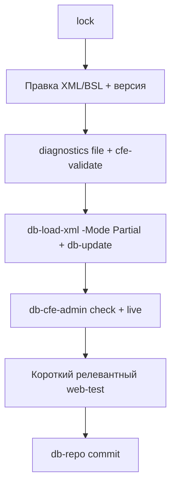

# Хранилище расширений 1С

Только расширения. Основную конфигурацию не трогать.

## Движок: скиллы контура

| Шаг | Скилл |
|-----|-------|
| Операции хранилища (lock / unlock / commit / update / connect / add-user) | `db-repo` — `{{SKILLS_ROOT}}\db-repo\scripts\db-repo.ps1` |
| Загрузка правок в ИБ (частичная) | `db-load-xml` — `{{SKILLS_ROOT}}\db-load-xml\scripts\db-load-xml.ps1` |
| Обновление конфигурации БД | `db-update` — `{{SKILLS_ROOT}}\db-update\scripts\db-update.ps1` |
| Гейты | bsl-analyzer `diagnostics file`, `cfe-validate`, `db-cfe-admin check`, `web-test`, ninja live |

Реквизиты хранилища берутся из `.v8-project.json` → `extensions[].repository` (`path`, `user`, `password`; `adminUser` — для `add-user`). Нет записи `repository` у расширения — операция не выполняется: сообщить и остановиться, путь не угадывать.

Хранилище работает с конфигурацией **в информационной базе**, не с XML на диске. Помещение без загрузки в ИБ оставляет в Конфигураторе и в хранилище старую версию.

## Порядок полного цикла (обязательный)

Агент **сам** гоняет гейты ниже — пользователь не обязан каждый раз просить «diagnostics / syntax / live до web».

### Куда что льётся (карта потоков — читать перед циклом)

| Шаг | Откуда → куда | Операция | Что это значит |
|-----|---------------|----------|----------------|
| `load` (ч.1) | файлы `src/cfe` → **Конфигуратор ИБ** | `db-load-xml -Mode Partial` (ключи хранилища подставляет скилл из реестра) | Черновик попадает в конфигурацию ИБ, хранилище **не тронуто** |
| `load` (ч.2) | Конфигуратор ИБ → **БД** | `db-update -Extension <Имя>` | Новая конфигурация применяется к данным — **здесь код впервые исполняется** |
| гейты | проверка **на живой ИБ** | diagnostics / db-cfe-admin check / live / web-test | Доводка до работы идёт на базе, а не в файлах |
| `commit` | Конфигуратор ИБ → **хранилище** | `db-repo commit` | В хранилище уезжает только то, что уже проверено на ИБ |

Порядок диктует платформа, а не вкус: `commit` в 1С всегда идёт **из ИБ**, а не из файлов, поэтому «сначала commit, потом проверка на базе» технически невозможна — в хранилище уедет старая конфигурация из Конфигуратора. Обратное («править сразу в Конфигураторе мимо файлов») запрещено: файлы — единственный ревьюируемый и версионируемый источник.

1. **Захват** (`db-repo lock`). Для новой метаданки или смены состава — всё расширение (`-All`).
2. **Правка XML/BSL** в `src/cfe` через профильные скиллы (`meta-*`, `subsystem-*`, `form-*`, `cfe-patch-method`, …). Версию поднять по `1c-versioning`.
3. **Гейты до load** (после правки BSL/структуры):
   - **bsl-analyzer** `diagnostics` `file` по каждому затронутому `.bsl` (`min_severity=warning`). Ложные срабатывания на `&НаСервере`+`&После` / сигнатуру перехвата — не блокер, если паттерн уже принят в модуле.
   - **cfe-validate** по каталогу расширения (скилл `cfe-validate`). Ошибки — стоп; warning вроде пустого DefaultLanguage — ок.
4. **Загрузка файлов в Конфигуратор ИБ** — `db-load-xml -Mode Partial` по списку правимых объектов (`-Files`/`-ListFile`), затем `db-update -Extension <Имя>` (в хранилище на этом шаге **ничего** не пишется).
   - Список файлов — объекты правки с их `Ext/` (например `Catalogs/Номенклатура.xml,Catalogs/Номенклатура/Ext/ObjectModule.bsl`); `Configuration.xml` в список **не включать** (платформа сделает полную загрузку, а она при хранилище запрещена).
   - После `lock`/`update`, если вывод сообщил о полученных из хранилища объектах, — сначала перевыгрузи их: `db-dump-xml -Mode Partial` (по названному в выводе файлу), и только потом правь исходники.
5. **Гейты после load** (до commit):
   - **`db-cfe-admin check -Name <Имя>`** — применимость + модули. Ошибки — стоп.
   - **Live-проверка** (ninja `live_check_syntax` / `live_eval` / `live_execute`) при доступности: дымовая проверка нового кода. Нет live — сообщить и не подменять «успехом»; для чисто структурных правок без BSL можно пропустить.
   - **web-test** короткий и **по смыслу правки** (открытие затронутой формы / точечный сценарий из `tools/web-test/scenarios/manual/` или inline). Не гонять полный UI-мастер, если доработка — серверный `&После`.
6. **Помещение** (`db-repo commit -Objects … -Comment "<что и версия>"`) **только после успешных гейтов 3 и 6**.

Нельзя: захват → правка XML → сразу помещение. Без load + гейтов в ИБ/хранилище уйдёт непроверенное.

Перед `load` закрой **Конфигуратор** для этой ИБ — иначе обновление БД упадёт с ошибкой блокировки. Сеанс с **MCP_Toolkit.epf** тоже держит базу — перед load закрой обработку / `close_1c_session`.



### Когда lock объекта vs всего расширения

| Ситуация | Что захватывать |
|----------|-----------------|
| Правка существующего объекта | Объект: `-Objects "Справочник.Номенклатура"` (форма/макет/команда — полным путём) |
| Новая метаданка / смена состава | Всё расширение: `-All` |
| Смена версии в `Configuration.xml` | Корень / объекты, которые реально меняешь; при сомнении — `-All` |

Освободить без помещения — `db-repo unlock`. Подтянуть из хранилища в ИБ (не из XML) — `db-repo update`.

---

## Операции `db-repo`

Общий префикс команды:

```powershell
powershell.exe -NoProfile -File "{{SKILLS_ROOT}}\db-repo\scripts\db-repo.ps1" -Command <подкоманда> <параметры>
```

### Рабочий цикл

| Подкоманда | Что делает |
|------------|------------|
| `lock` | Захватить объекты |
| `unlock` | Отменить захват |
| `commit` | Поместить изменения в хранилище |
| `update` | Получить изменения из хранилища |

Параметры: `-Objects` (через запятую), `-ObjectsFile`, `-All`, `-WithChildren`, `-Comment`, `-KeepLocked`, `-Revised`, `-Extension <Имя>`; оверрайды `-RepositoryPath` / `-RepositoryUser` / `-RepositoryPassword`. Подключение к базе — **явно**: `-InfoBasePath` или `-InfoBaseServer` + `-InfoBaseRef` (+ `-UserName`); запись в `.v8-project.json` сопоставляется по этим параметрам и даёт реквизиты хранилища расширения.

### Смежные подкоманды

| Подкоманда | Что |
|------------|-----|
| `connect` / `disconnect` | Подключение/отключение базы к хранилищу |
| `create` / `add-user` / `copy-users` | Создание хранилища, пользователи (для `add-user` — `adminUser` из записи реестра) |
| `dump-cfg` / `report` / `set-label` / `optimize` / `clear-cache` | История версий, метки, обслуживание |

### `-Force` — только с явного согласия

| Подкоманда | Что делает |
|------------|------------|
| `unlock` | **Теряет локальные правки**: объекты перезаписываются версией из хранилища |
| `commit` | Пытается очистить ссылки на удалённые объекты вместо ошибки |
| `update` | Подтверждает добавление и удаление объектов конфигурации |

### Имена объектов

Объект — `Справочник.Номенклатура`. Форма, макет, команда — полным путём:
`Документ.ЗаказПокупателя.Форма.ФормаДокумента`, `Справочник.Номенклатура.Макет.Печать`.

Если объект «не найден» — он мог появиться в хранилище позже, чем обновлялась база (`db-repo update`), либо это не объект хранилища (реквизит/табличная часть правится в составе владельца).

## Результат

Нулевой код не означает, что что-то изменилось. Под нулём приходят «уже захвачено», «обновлять нечего», «помещать нечего» и частичный захват — когда часть объектов занята другими. **Читай текст вывода, а не только код.**

## Требуют подтверждения пользователя

| Операция | Почему |
|----------|--------|
| `lock -All` | Захватывает всё расширение: на большой базе идёт долго и блокирует работу команды |
| `unlock -Force` | Теряются локальные правки захваченных объектов |
| `disconnect` | Теряется подключение базы к хранилищу, в том числе на стороне хранилища |
| `connect -ForceReplaceCfg` | Конфигурация базы заменяется конфигурацией из хранилища |

## Почему не обычная загрузка

| Что | Почему нельзя |
|-----|----------------|
| Полная `db-load-xml` (весь каталог) | Платформа запрещает полную загрузку при хранилище. Нужна **частичная** (`-Mode Partial` по списку) |
| `Configuration.xml` в списке файлов | Платформа выполнит полную загрузку |
| Загрузка без ключей хранилища | «Загрузка невозможна: текущая конфигурация помещена в хранилище» — ключи подставляет `db-load-xml` из записи `extensions[].repository` |

## web-test

Конфиг проекта: `tools/web-test/smoke.config.json` — `webUrl`, сценарии по расширению в `extensions`, `defaultScript`.

| Когда | Что |
|-------|-----|
| Полный цикл до commit | Свой короткий сценарий по затронутой форме/документу (см. гейт 5) |
| Пример OPV after-load | `opv.js` — подвал реализации/корректировки, **не** ГТД/возврат |

Сценарии: `tools/web-test/scenarios/after-load/` и `manual/`. Закрытие форм — `closeForm({ save: false })`. Skill: `web-test`.

## Правки XML расширения

- Собственный объект: префикс из `<NamePrefix>` в `Configuration.xml` и `<ObjectBelonging>Native</ObjectBelonging>`.
- Корень расширения остаётся `Adopted`. Не грузить XML расширения в основную конфигурацию.
- После `load` может обновиться `ConfigDumpInfo.xml` — это ожидаемо.

## Жёсткие правила

- Один пользователь хранилища на ИБ — из записи реестра (не заводить второго на ту же базу).
- **Не** коммитить в хранилище, пока гейты 3 и 6 не зелёные (или явно согласован пропуск live/web с пользователем при недоступности публикации).
- Пользователь не обязан каждый раз просить гейты — агент проходит цикл сам.

## Сбои

| Симптом | Действие |
|---------|----------|
| Блокировка при обновлении БД | Закрыть Конфигуратор / toolkit-сеанс, повторить `db-update` |
| Объект не захвачен | `db-repo lock`, затем снова load |
| Нет записи `repository` у расширения | Стоп, сообщить; не угадывать путь хранилища |
| Live / web недоступны | Сообщить; не помечать гейт «успехом»; commit только с явным согласием пользователя на пропуск |
| «Соединение с хранилищем не установлено» при `db-dump-xml` | Реквизиты хранилища берутся из реестра; проверить `extensions[].repository` и доступность хранилища |
